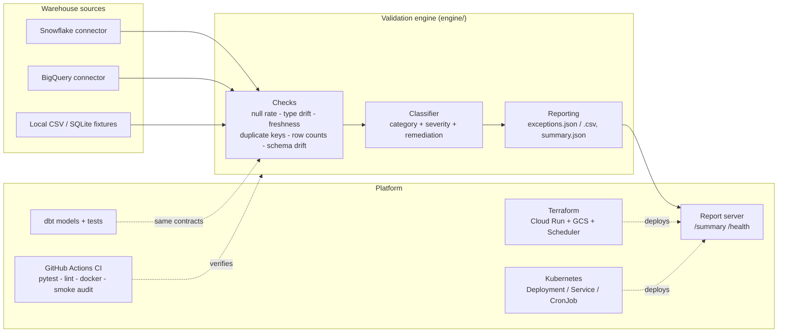

# Cloud Data Governance & CI/CD Pipeline Engine

A data-quality validation engine that audits cloud data warehouse schemas
(Snowflake and GCP BigQuery), classifies every exception it finds by type
and severity, and publishes structured exception logs and summary reports —
with dbt models enforcing the same contracts at build time, Terraform
deploying the service, and Docker/Kubernetes/CI wiring it all together.

The whole demo runs **offline**: a local connector serves warehouse fixtures
from CSV, so `run-audit` works with no cloud credentials.

## Architecture



## What it does

For every table in the expected-schema contract, the engine runs six checks:

| Check | Detects |
|---|---|
| `null_rate` | Columns whose null fraction exceeds its threshold |
| `type_drift` | Columns whose inferred value types no longer match the contract (e.g. `N/A` strings in a FLOAT column) |
| `schema_drift` | Missing or unexpected columns vs the contract |
| `duplicate_key` | Duplicated primary-key values |
| `freshness` | Tables whose latest timestamp is older than the allowed window |
| `row_count_anomaly` | Row counts outside the expected range (partial/double loads) |

Each finding is classified (`engine/classifier.py`) into a category
(completeness, schema conformance, uniqueness, timeliness, volume), a
severity (`critical`/`high`/`medium`/`low`, scaled by the finding's
metrics), and a recommended remediation action, then written to the
exception log.

## How the resume bullets map to code

| Resume bullet | Where it lives |
|---|---|
| "Python and dbt data validation engine to audit cloud data warehouse schemas in Snowflake and BigQuery" | `engine/checks.py`, `engine/connectors/snowflake_connector.py`, `engine/connectors/bigquery_connector.py`, `dbt_project/` |
| "...with 94% accuracy, automating exception logging and quality classification" | `engine/classifier.py` + `scripts/score_accuracy.py` measured against the labeled fixtures in `fixtures/expected_exceptions.json` (see "Measured accuracy" below) |
| "Infrastructure as Code & CI/CD: Terraform and GitHub Actions..." | `terraform/`, `.github/workflows/ci.yml` |
| "...deploy containerized data validation services on Docker and Kubernetes" | `Dockerfile`, `docker-compose.yml`, `k8s/` |
| "...enforcing automated testing, security, and data governance controls" | `tests/`, dbt tests in `dbt_project/models/schema.yml`, severity gating via `run-audit --fail-on-critical` |

## Measured accuracy

The fixtures plant six labeled data-quality issues (see
`fixtures/README.md`). Scoring the engine's exception log against those
labels after a local demo run:

```
planted issues: 6 | detected: 6 | correctly classified: 6
accuracy (recall): 100.0% | precision: 100.0% | missed: [] | false positives: []
```

Reproduce any time with `python main.py run-audit --source local --report out/`
followed by `python main.py score`. (Accuracy is measured on this labeled
fixture set; it is a small, deliberately separable benchmark, not a
production guarantee.)

## Quick start (offline demo)

```bash
python -m venv .venv && source .venv/bin/activate
pip install -r requirements-dev.txt        # pytest for the test suite

python main.py run-audit --source local --report out/
# Audited 6 tables, 1072 rows scanned ... Exceptions found: 6

python main.py score                        # accuracy vs labeled fixtures
python -m pytest                            # full test suite
```

Outputs land in `out/`:

- `exceptions.json` — structured exception log (table, column, check,
  category, severity, message, metrics, recommended action)
- `exceptions.csv` — the same log, flat, for spreadsheets/tickets
- `summary.json` — totals by severity / check / category / table

### Docker

```bash
docker compose run --rm audit               # writes ./out/*
docker compose up report-server             # http://localhost:8080/summary
```

### Against a real warehouse

```bash
pip install -r requirements-connectors.txt
export SNOWFLAKE_ACCOUNT=... SNOWFLAKE_USER=... SNOWFLAKE_PASSWORD=...
export SNOWFLAKE_DATABASE=... SNOWFLAKE_SCHEMA=...
python main.py run-audit --source snowflake --report out/

export BIGQUERY_PROJECT=my-project BIGQUERY_DATASET=warehouse  # + GCP ADC
python main.py run-audit --source bigquery --report out/
```

### dbt

`dbt_project/` models the audited tables and enforces the contract with
generic tests (`unique`, `not_null`, `accepted_values`, `relationships`).
See `dbt_project/README.md`.

### Terraform / Kubernetes

`terraform/` provisions the GCP side: Artifact Registry repo, report
bucket, service account, Cloud Run report service, Cloud Run audit job and
a Cloud Scheduler trigger. `k8s/` carries the equivalent container
platform manifests — a Deployment + Service for the report server and a
CronJob for the scheduled audit.

## Project structure

```
.
├── main.py                     # CLI entry point
├── engine/
│   ├── cli.py                  # run-audit / score commands
│   ├── audit.py                # audit orchestration
│   ├── checks.py               # the six validation rules
│   ├── classifier.py           # category + severity classification
│   ├── models.py               # schema contract + exception records
│   ├── reporting.py            # JSON/CSV exception log + summary
│   ├── server.py               # stdlib report server (/summary, /health)
│   └── connectors/
│       ├── base.py             # connector interface
│       ├── local_connector.py  # CSV / SQLite fixtures (offline)
│       ├── snowflake_connector.py
│       └── bigquery_connector.py
├── fixtures/                   # offline warehouse + labeled ground truth
├── scripts/
│   ├── generate_fixtures.py    # deterministic fixture generator (seed 42)
│   └── score_accuracy.py       # classifier accuracy vs labels
├── dbt_project/                # dbt models + generic tests
├── terraform/                  # GCP: Cloud Run, GCS, Scheduler, IAM
├── k8s/                        # deployment, service, cronjob
├── tests/                      # pytest: checks, classifier, connector, e2e
└── .github/workflows/ci.yml    # pytest + lint + docker build + smoke audit
```

## Stack

Python · dbt · SQL · Snowflake · Terraform · GCP BigQuery · Docker · Kubernetes
